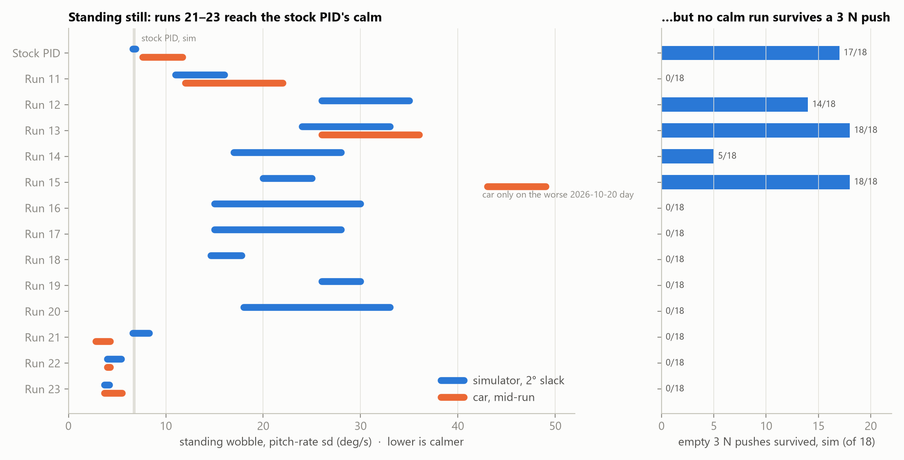

# DIP-E026 — RL self-balancing robot: project overview

*Status as of 2026-10-23, after run 23. The details behind each claim are in the
`session-logs/` file named in each section.*

## 1. Goal and set-up

**Goal:** replace the Yahboom balance car's stock PID with a neural-network
policy that balances, drives, turns and recovers from pushes, trained in
simulation and run on the car's STM32.

| part | what it is |
|---|---|
| Car | Yahboom STM32F103 (no FPU, 64 KB usable flash), MPU6050 IMU, AT8236 driver, JGB37-520 geared motors |
| Simulator | MuJoCo 3.2.7: `real_robot.xml` (measured mass and inertia, rotors behind a gearbox with slack) and `motor_model.py` (PWM to torque, as measured) |
| Policy | PPO (Stable-Baselines3), MLP 34 → 64 → 64 → 2, tanh, 6,530 parameters; inputs are what the firmware can compute; outputs are two wheel PWMs |
| Control | 200 Hz. PWM = sign(a)·(\|a\|·1500 + 1300), clamped at 2800; the +1300 is the firmware's dead-zone compensation |
| Deployment | `export_stm32.py` → `policy_weights.h` (float) and `policy_weights_q.h` (int16) → Keil mode-28 firmware → flashed with FlyMCU |
| Workflow | Desktop trains and checks in simulation; laptop builds, flashes, tests and pushes car logs (`TRAINING_ON_DESKTOP.md`) |

**How a policy is judged:**
- **Standing wobble:** the standard deviation of pitch rate while standing,
  in deg/s, measured mid-run.
- **Push survival:** 3 N for 0.1 s, 10 cm above the axle, over 18 trials
  (3 seeds × 3 delays × 2 directions).
- **Command tracking:** how closely it follows forward, reverse and turn
  commands.
- **Motor reversals:** sign flips per second per wheel.
- **The target is the stock PID:** 6.6–6.9 deg/s in the simulator, 7.6 on
  the car, and 17 of 18 pushes survived.

## 2. Phase 1: from falling to balancing (runs 1–9)

| problem | reasoning | fix | result |
|---|---|---|---|
| Early plant too easy | A PID balanced the first model, but that model was 3.5× off in centre-of-mass height and 12× off in inertia | Rebuilt `real_robot.xml` from measured parameters | A realistic plant |
| Steady drift in simulation | The policy had no memory of position or heading | History inputs, an action-rate penalty, leaky position and heading integrals | Run 7 converged in simulation |
| Run 7 fell on the car within 0.2–2 s | (a) Firmware: a half-rate loop and a stack overflow. (b) Car logs: the motor gives almost nothing below about 1460 counts, but the simulator treated the +1300 as useful torque | The team fixed the firmware; run 8 modelled the dead zone and trained only on firmware-observable inputs, with IMU errors and 1–2 ticks of delay | **Run 8 balanced on the car** (17–51 s per run) |
| Large "wobble" on the car | Suspected delay (run 9) and gear slack (run 10) | Both modelled in training | Still looked wobbly; see §3 |

## 3. Phase 2: measuring the real car (2026-10-08)

The wobble numbers didn't fit the simulator, so we measured instead of
guessing.

- **Motor tests on the car** (step, reversal, low-PWM):
  - torque limit 0.75 N·m;
  - dead zone with stiction: 1485 counts at rest, falling to 1400 by
    about 1 rad/s;
  - Coulomb friction 0.011 N·m, viscous 0.00054 N·m·s/rad;
  - rotor armature 1.5e-3 kg·m²;
  - about 2° of gear slack, at most 15 ms of delay.

  These went into `motor_model.py`.
- **The stock PID through the measured model matches the car**
  (6.6–6.9 against 7.6 deg/s), so the simulator is trustworthy.
- **Measurement error found.** The flight recorder's E lines (the last
  0.6 s) had recorded the final hand push, not the balancing, so runs 8, 9
  and 11's "95 / 68 / 57.5 deg/s" were wrong. From the 200 Hz stream, run
  11's real mid-run wobble is **12–22 deg/s**, and the simulator gives
  13.5–21. Since then, wobble is judged from the stream, mid-run.
- Also ruled out: the attitude filter, int16 quantisation, gyro vibration.

## 4. Phase 3: push recovery (runs 11–13)

| run | change | standing, sim 2° | 3 N survived | car |
|---|---|---|---|---|
| 11 | wobble penalty 1.5, no pushes | 11–16 | 0/18 (1 N max) | 12–22 |
| 12 | measured motor, random pushes 0–4 N, no penalty | 26–35 | 14/18 | — |
| 13 | run 12 fine-tuned with penalty 0.5 | 24–33 | **18/18** | **26–36**, as predicted |

- Pushes in training work, but standing got about twice as wobbly.
- **Firmware fixes for run 13:**
  - `CMD_W` 0.5 → 1.0 rad/s: turning was limited by the firmware, not the
    policy, which tracks 1.5 rad/s in the simulator;
  - pitch and roll zero fixed at 0, so `cal` only measures the gyro bias,
    in any still pose. On the car: no creep.
- `cal` is still needed: the gyro bias (about 0.04 rad/s) is 14× what
  training randomises.

## 5. Phase 4: calm *and* push-proof (runs 14–17)

| run | suspect | change | standing 2° / 4° | 3 N | verdict |
|---|---|---|---|---|---|
| 14 | penalty too weak | penalty 1.5, from scratch | 17–28 | 5/18 | Calmer, but lost pushes |
| 15 | 10–23 % of training shoves were beyond even the PID's limit (it survives 3 N, never 4 N) | shoves capped at 3 N; penalty paused 1 s after each shove | 20–25 / 35–44 | **18/18** | **Current policy**, on the car |
| 16 | motor reversals kick through the gear slack (laptop, §6) | reversal penalty 0.5; slack 0–6° | 15–30 / 38–45 | 0/18 | Fail |
| 17 | 0.5 too strong | reversal penalty 0.3 | 15–28 / 27–42 | 0/18 | Fail |

**The pattern behind all four:** calm while the curriculum is still ramping
up, shaking again once it reaches full strength (about 15M of 30M steps).

| checkpoint | standing 2° | reversals /s |
|---|---|---|
| run 14 at 11.75M | 10–13 | — |
| run 15 at 11M | 9.8–11.9 | — |
| run 16 at 10M | **2.6–3.1** (4°: 2.7–5.0), calmer than the PID | 1–4 |
| run 16 at 16.5M | 4.3–10.8 | 3–16 |
| run 16 at 30M | 15–30 | 18–24 |

**Conclusion:** the network *can* be calm (it was below the PID's level),
so the network size and the tanh activation aren't the limit. Changing
reward weights hasn't stopped the shake returning. Something in the
full-strength curriculum brings it back.

## 6. Why the policies shake (laptop, 2026-10-20)

- On the car, more than 95 % of the policies' wobble is above 3 Hz, peaking
  at 7–10 Hz. They reverse 10–30 times a second; the PID rarely does.
- **Mechanism:** the policy reverses → the rotor crosses the gear slack and
  hits the far side → the jolt shows on the gyro → the policy reverses again.
  The PID moves its PWM by about 13 counts per tick and stays on one side of
  the gap.
- The rate penalty misses this: a 0.1 → −0.1 action flip costs almost
  nothing, but through the +1300 compensation it is a 2,600-count swing.
- **The car varies from day to day.** On 2026-10-20 the PID was at 11.7
  deg/s (from 7.6), which fits about 4° of slack. Run 15 measured 43–49 that
  day.
- **Ruled out:**
  - calibration;
  - battery voltage: the policies barely notice it, though it weakens the
    PID;
  - an output low-pass filter: fewer reversals, but no less wobble, because
    the lag makes the loop slower and larger.

## 7. Other checks

| question | answer |
|---|---|
| Try another activation? | No. Tanh is bounded (safe with odd inputs, clean int16) and PPO's proven default; its speed cost on the STM32 is fixed with a fast approximation (error 1.9e-2). The same network reached 2.6 deg/s, so the activation isn't the limit. |
| Sridevi's week-9 branch "more stable"? | Her car logs are the **stock PID** (mode 0 throughout, 7.0 deg/s, the same as ours); her network was never selected on the car. Her simulator has no slack, dead zone or delay. Worth taking: her hardware watchdog (but only 288 B of flash are left). |
| Windows problems | Efficiency mode cut training to a quarter of its speed; the script now opts out. Smart App Control blocked MuJoCo 3.2.3; pinned to 3.2.7, which gives identical results. |

## 8. Diagnostics: what brings the shake back (2026-10-21)

Four 10M-step runs on run 17's settings, each holding back one of the three
things that reach full strength around 15M (flags `--push-cap`, `--cmd-cap`,
`--payload-cap` in `train_real_robot.py`), plus a control with nothing held
back:

| run | held back | wobble 2° / 4° (deg/s) | reversals /s (2°) | 2 N pushes survived |
|---|---|---|---|---|
| D | nothing (control) | 19.5–30.1 / 37–45 | 20–29 | 11/18 |
| A | shoves at 50 % | 18.7–27.0 / 25–35 | 20–24 | 0/18 |
| B | commands at 50 % | 14.4–22.7 / 29–36 | 19–28 | 10/18 |
| **C** | **no payload** | **4.6–10.2** / 21–30 | **5–13** | **0/18** |

- **The payload (0–1 kg in training) causes the shake.** Training for a
  loaded car teaches stiff, high-gain control, which on an empty car
  overshoots and kicks through the gear slack. Shoves and commands don't.
- **The same stiffness was providing the push recovery:** without payload,
  C survives no 2 N push.

**Payload sweep (simulator, 2° slack; the car itself is 0.94 kg):**

| | standing 0 / 1 / 4 kg (deg/s) | driving ±0.25 m/s, runs held (of 3) at 0 / 1 / 2 / 4 kg |
|---|---|---|
| run 15 (trained 0–1 kg) | 19.5–24.5 / 8–10 / 7–8 | 3 / 3 / 3 / 3 |
| C (no payload) | 7–10 / 6.5–8 / 7–8 | 3 / 3 / **1 / 0** |

- Extra mass makes standing easier: every policy is calmer with load.
- But a policy trained without payload can't **drive** with 2 kg or more.
  Calm when empty and firm when loaded needs either training for the actual
  load range, or the payload given to the network as an input.

## 9. Results by run (2026-10-24)

- Standing wobble is the pitch-rate sd mid-run. "sim" is at 2° slack and 5–15 ms; "car" is the
  200 Hz stream.
- Pushes are empty, 0.1 s, in simulation, out of 18.
- Runs 8–10 balanced on the car too. Their logged wobble was the final push (the E-line
  artifact), so it isn't comparable.

| run | main change | sim (deg/s) | car (deg/s) | 3 N / 2 N pushes | verdict |
|---|---|---|---|---|---|
| stock PID | — | 6.6–6.9 | 7.6 (11.7 on a worse day) | 17 / 18 | the reference |
| 11 | wobble penalty, no pushes | 11–16 | 12–22 | 0 / 0 | calm, push-fragile |
| 12 | measured motor, pushes 0–4 N | 26–35 | — | 14 / — | push-proof, wobbly |
| 13 | 12 + penalty 0.5 | 24–33 | 26–36 | 18 / 18 | push-proof, wobbly, as predicted |
| 14 | penalty 1.5, from scratch | 17–28 | — | 5 / — | lost pushes |
| 15 | pushes ≤ 3 N, penalty paused | 20–25 | 43–49 (worse day) | 18 / 18 | shakes through the gear slack on the car |
| 16–17 | reversal penalty 0.5 / 0.3 | 15–30 | — | 0 / — | fail |
| 18 | no payload | 14.6–17.8 | — | 0 / — | fail |
| 19–20 | PWM-step penalty; `osc`/`lean` inputs | 18–33 | — | 0 / 0–10 | still shaky empty |
| **21** | shake-band (`osc`) penalty | 6.6–8.3 | **2.8–4.3** | 0 / 1 | first calm on the car; creeps with the floor |
| **22** | 8 s position memory, slopes | 4.0–5.4 | **4.0–4.3** (2 kg 2.7) | 0 / 17 | calm, quick push return; needs trim 1.7° (2.5° with 2 kg) |
| **23** | full position memory | 3.7–4.2 | **3.7–5.5** (2 kg 3.6–4.9) | 0 / 13 | no creep, no trim; swings ±10–20 cm, slow after pushes |

Session logs: runs 22 and 23 on the car are in `session-logs/2026-10-22-run22-on-car.md` and
`2026-10-24-run23-on-car.md`.

## 10. Current state and next steps

- **On the car (2026-10-24):** run 23. It removes the creep and the trim, but swings around its
  spot and settles slowly after pushes. Run 22 recovers better but needs a trim per load. A 30 s
  memory (run 24) is the middle option, left for now.

- **On the car (2026-10-21):** run 21 at 21M stood at 2.8–4.3 deg/s, calmer than the stock PID
  (7.6–11.7). It crept 1–2 cm/s with the room's floor slope and wandered after pushes.
- **On the car (2026-10-22):** run 22 at 24M: 4.0–4.3 deg/s empty, 2.7 with 2 kg, creep
  0.1–0.5 cm/s at the right trim (1.7° empty, about 2.5° with 2 kg); every hand push
  survived. Log: `session-logs/2026-10-22-run22-on-car.md`.
- **Exported next: run 23 at 25.5M** (`models/best_real`): run 22 with a position memory that
  never forgets, like the stock PID's speed loop. In simulation the creep stops within about
  30 s on any slope or trim error, empty or loaded (run 22 keeps creeping). It is the steadiest
  policy yet on a worse-geared car (5.6–9.9 deg/s at 4° slack). Empty 2 N pushes: 13/18.
  Log: `session-logs/2026-10-23-run23-desktop.md`.
- **Runs 19–21 (2026-10-21, payload 0–2 kg; simulator results, 2° slack):**

  | run | change | empty wobble at about 20M (deg/s) | 2 kg | empty 2 N pushes |
  |---|---|---|---|---|
  | 19 | PWM-change penalty, calm penalties only near upright | 26–30 | calm, 3 N 18/18 | 0/18 |
  | 20 | + `osc`/`lean` inputs (teammate's `load_adapt.c`) | 18–33 | calm, 3 N 18/18 | 10/18 |
  | 21 | + a reward charge on `osc` (the shake band only) | **6.6–8.3** | calm, 4 N 18/18 | 1/18 |

  Run 21 is the first policy calm both empty and loaded. Push recovery on an empty
  car is the open problem: the policy eases off as the car tips. Logs:
  `session-logs/2026-10-21-run19…run21-desktop.md`.
- **Run 18 (no payload, 30M): fail.** Standing at 2° was 14.6–17.8 deg/s (C at 10M:
  4.6–10.2). It lost all 3 N pushes and the final checkpoint can't drive with 1 kg.
  So payload wasn't the only cause: long time at full curriculum strength brings the
  shake back too (`session-logs/2026-10-21-run18-desktop.md`).
- **Next, depending on the load the car must carry:**
  1. Cheapest: keep a checkpoint every 1M steps and pick the calmest one that
     still passes pushes (runs 15 and 16 were calm at 10–11M).
  2. Run 19 adds a penalty on the actual PWM change
     and makes the wobble and PWM penalties apply only near upright, so it can
     fight hard only when knocked over.
  3. Heavy or varying load: the payload as an extra network input (firmware
     change, about 128–256 B of the 288 B of flash left).
  4. Fallback: start from the PID (behaviour cloning), then PPO fine-tuning.
- **Hardware:** the gear slack is the physical root of the shake. Less
  backlash, or a consistent car, would help any controller.

Figures for all of the above: `report_figures/` (`python
sim_tools/report_figures.py`).

## 11. Where to look

| | |
|---|---|
| How to train, deploy and test | `TRAINING_ON_DESKTOP.md`, `firmware/README-STM32-DEPLOYMENT.md` |
| Measured motor and the E-line artifact | `session-logs/2026-10-08-*` |
| Runs 12–13 | `session-logs/2026-10-08-run12-measured-motor-and-pushes.md` |
| Turning, calibration, MuJoCo | `session-logs/2026-10-10-turning-calibration-mujoco.md` |
| Runs 13–17 and the shake | `session-logs/2026-10-14-*`, `2026-10-18-*`, `2026-10-20-*`, `2026-10-21-*` |
| Car logs | `car_logs/<date>/` |
